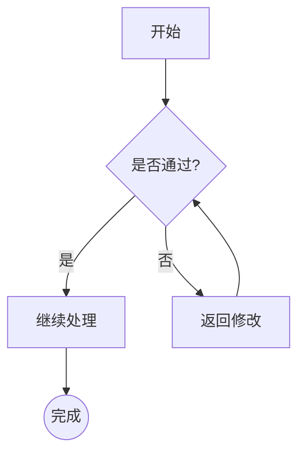
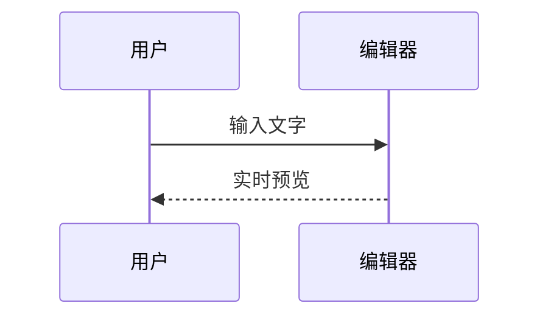
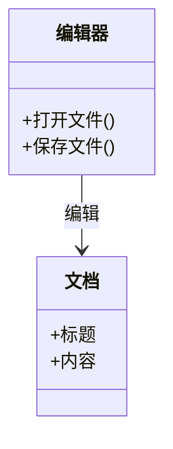
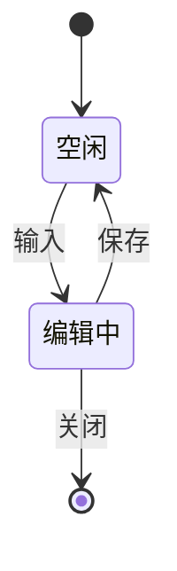
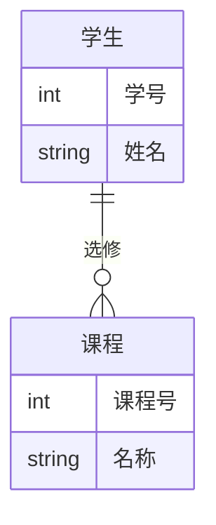
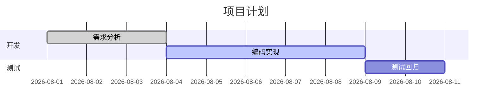
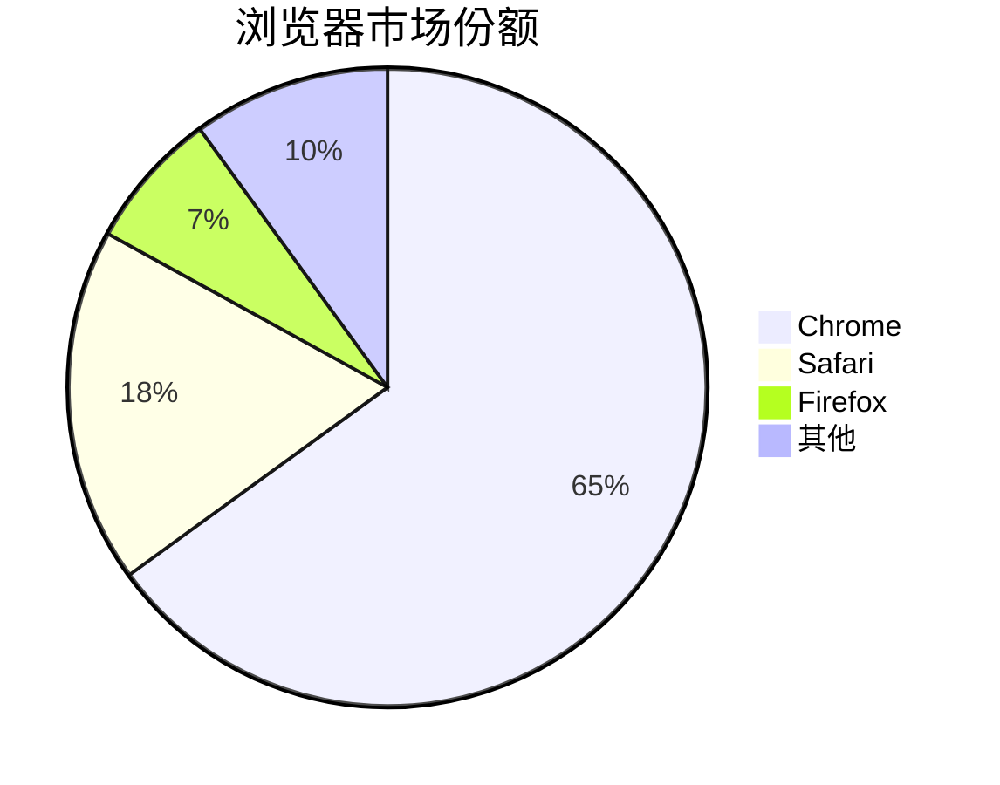
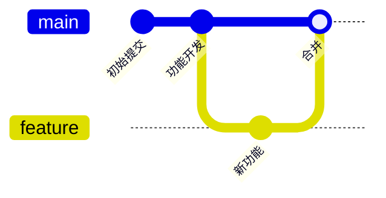
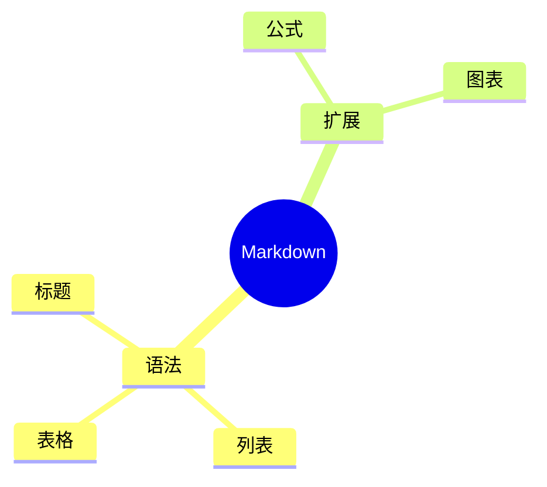
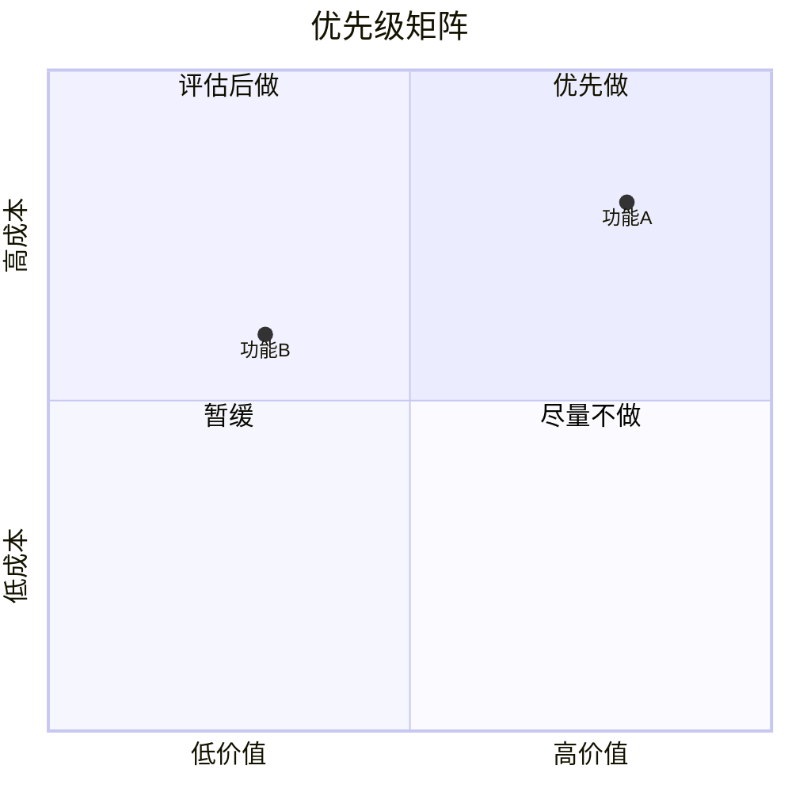

# Markdown 语法参考

> 本文档由编辑器实时渲染：每个示例上方为 **Markdown 源码**，下方为 **预览效果**。
> - 使用左侧「大纲」面板可按标题快速跳转。
> - 文中链接可直接点击，在浏览器中打开。

## 1. 标题

使用 `#` 号标记，`#` 的数量表示标题级别（1–6）。

```markdown
# 一级标题
## 二级标题
### 三级标题
#### 四级标题
##### 五级标题
###### 六级标题
```

## 2. 文本格式

| 语法 | 效果 |
|------|------|
| `**粗体**` | **粗体** |
| `*斜体*` | *斜体* |
| `~~删除线~~` | ~~删除线~~ |
| `==高亮==` | ==高亮== |
| `` `行内代码` `` | `行内代码` |

## 3. 链接与图片

```markdown
[链接文字](https://example.com)


```

[链接文字](https://example.com)

## 4. 引用块

```markdown
> 这是一段引用文字。
> 可以有多行。
```

> 这是一段引用文字。
> 可以有多行。

## 5. 列表

无序列表使用 `-`、`*` 或 `+`：

```markdown
- 项目一
- 项目二
  - 嵌套项目
```

- 项目一
- 项目二
  - 嵌套项目

有序列表使用数字加 `.`：

```markdown
1. 第一步
2. 第二步
3. 第三步
```

1. 第一步
2. 第二步
3. 第三步

任务列表：

```markdown
- [ ] 待办事项
- [x] 已完成事项
```

- [ ] 待办事项
- [x] 已完成事项

## 6. 代码块

使用三个反引号包裹，可指定语言进行语法高亮：

```cpp
#include <iostream>
int main() {
    std::cout << "Hello, World!" << std::endl;
    return 0;
}
```

### 展示代码块原始内容

若要在文档中展示一段**含反引号围栏**的原始源码（例如讲解 Markdown 代码块写法本身），外层用更多反引号（四个及以上）包裹，内层围栏即作为字面内容显示：

````markdown
```cpp
#include <iostream>
int main() {
    std::cout << "Hello, World!" << std::endl;
    return 0;
}
```
````

## 7. 表格

```markdown
| 列A | 列B | 列C |
|-----|-----|-----|
| A1  | B1  | C1  |
| A2  | B2  | C2  |
```

| 列A | 列B | 列C |
|-----|-----|-----|
| A1  | B1  | C1  |
| A2  | B2  | C2  |

## 8. 分割线

使用三个或以上的 `---`、`***` 或 `___`：

---

## 9. 常用 HTML 标签

编辑器支持手写 HTML 标签。有 Markdown 等价语法的标签（`<sub>`、`<sup>`、`<mark>`、`<hr>`）导出时会转为标准 Markdown 语法；无等价语法的（`<br>`、`<kbd>`、`<small>`、`<span>`、`<div>`）保留字面 HTML。

### 下标与上标

| 写法 | 效果 |
|------|------|
| `H~2~O` | H~2~O |
| `H<sub>2</sub>O` | H<sub>2</sub>O |
| `x^2^` | x^2^ |
| `x<sup>2</sup>` | x<sup>2</sup> |

### 高亮、按键与小字

| 写法 | 效果 |
|------|------|
| `==高亮==` | ==高亮== |
| `<mark>高亮</mark>` | <mark>高亮</mark> |
| `<kbd>Ctrl</kbd>+<kbd>S</kbd>` | <kbd>Ctrl</kbd>+<kbd>S</kbd> |
| `<small>小字</small>` | <small>小字</small> |
| `<u>下划线</u>` | <u>下划线</u> |

### 换行

`<br>` 用于硬换行（Markdown 中普通回车是软换行，不产生换行）：`第一行<br>第二行` 渲染为 第一行<br>第二行。

### 内联样式与块级容器

<span style="color:red">红色文字</span> —— 写法：`<span style="color:red">红色文字</span>`

<div align="center">居中的段落</div> —— 写法：`<div align="center">居中的段落</div>`

分割线：`<hr>` 与 `---` 等价，均渲染为分割线。

## 10. 数学公式

### 行内公式

使用单个 `$` 包裹，公式嵌入文字中。源码：

```markdown
质能方程 $E=mc^2$ 是爱因斯坦提出的。
```

嵌入后：质能方程 $E=mc^2$ 是爱因斯坦提出的。

### 块级公式

使用两个 `$$` 包裹，公式独占一行居中显示。源码：

```markdown
$$
E = mc^2
$$
```

$$
E = mc^2
$$

### 常用 LaTeX 语法

#### 上下标

| 语法 | 渲染 | 说明 |
|------|------|------|
| `x^2` | $x^2$ | 上标（单个字符） |
| `x^{10}` | $x^{10}$ | 上标（多个字符需 `{}` 包裹） |
| `x_i` | $x_i$ | 下标 |
| `x_{ij}` | $x_{ij}$ | 下标（多个字符） |
| `x_i^2` | $x_i^2$ | 上下标组合 |
| `x_{i}^{2}` | $x_{i}^{2}$ | 上下标组合（推荐加 `{}` 明确范围） |

> **重要**：`^` 和 `_` 默认只作用于**紧随其后的一个字符**。要作用多个字符，必须用花括号 `{...}` 包裹。
>
> - `c^22` 渲染为 $c^22$（只有第一个 `2` 是上标）
> - `c^{22}` 渲染为 $c^{22}$（`22` 整体是上标）

#### 分数

```latex
\frac{分子}{分母}
```

$$
\frac{a}{b} \qquad \frac{x+1}{y-2}
$$

#### 根号

```latex
\sqrt{被开方数}          % 平方根
\sqrt[n]{被开方数}       % n 次方根
```

$$
\sqrt{x} \qquad \sqrt[3]{8} = 2
$$

#### 求和、积分、乘积

```latex
\sum_{i=1}^{n} x_i       % 求和
\int_{a}^{b} f(x)\,dx    % 积分
\prod_{i=1}^{n} x_i      % 乘积
\lim_{x \to \infty} f(x) % 极限
```

$$
\sum_{i=1}^{n} x_i \qquad \int_{a}^{b} f(x)\,dx
$$

$$
\prod_{i=1}^{n} x_i \qquad \lim_{x \to \infty} f(x)
$$

> 在块级公式（`$$...$$`）中，求和与积分的上下限会显示在符号正上/下方；在行内公式（`$...$`）中则显示为角标。

#### 希腊字母

```latex
\alpha \beta \gamma \delta \epsilon
\theta \lambda \mu \pi \sigma
\phi \omega \Omega \Delta \Gamma
```

$$
\alpha \quad \beta \quad \gamma \quad \delta \quad \epsilon
$$
$$
\theta \quad \lambda \quad \mu \quad \pi \quad \sigma
$$
$$
\phi \quad \omega \quad \Omega \quad \Delta \quad \Gamma
$$

#### 括号

```latex
(x) \quad [x] \quad \{x\}
\left( \frac{a}{b} \right)   % 自适应高度
```

$$
(x) \quad [x] \quad \{x\} \qquad
\left( \frac{a}{b} \right)
$$

#### 矩阵

```latex
\begin{pmatrix}
a & b \\
c & d
\end{pmatrix}
```

$$
\begin{pmatrix}
a & b \\
c & d
\end{pmatrix}
$$

#### 多行公式（aligned 环境）

```latex
\begin{aligned}
x &= a + b \\
y &= c + d \\
z &= x + y
\end{aligned}
```

$$
\begin{aligned}
x &= a + b \\
y &= c + d \\
z &= x + y
\end{aligned}
$$

#### 常用符号速查

| 符号 | 语法 | 渲染 |
|------|------|------|
| 乘号 | `\times` | $\times$ |
| 除号 | `\div` | $\div$ |
| 正负 | `\pm` | $\pm$ |
| 点乘 | `\cdot` | $\cdot$ |
| 小于等于 | `\le` | $\le$ |
| 大于等于 | `\ge` | $\ge$ |
| 不等于 | `\neq` | $\neq$ |
| 约等于 | `\approx` | $\approx$ |
| 无穷 | `\infty` | $\infty$ |
| 属于 | `\in` | $\in$ |
| 子集 | `\subset` | $\subset$ |
| 空集 | `\emptyset` | $\emptyset$ |
| 任意 | `\forall` | $\forall$ |
| 存在 | `\exists` | $\exists$ |
| 箭头 | `\to` `\rightarrow` `\Rightarrow` | $\to$ $\rightarrow$ $\Rightarrow$ |
| 角度 | `\angle` | $\angle$ |
| 度数 | `30^\circ` | $30^\circ$ |

### 编辑数学公式

- **双击**渲染后的公式即可编辑 LaTeX 源码，实时预览
- `Ctrl+M` 插入行内公式，`Ctrl+Shift+M` 插入块级公式
- 工具栏 ∑ 按钮也可快速插入行内公式

## 11. Mermaid 图表

Mermaid 是一种用纯文本绘制图表的语法。将源码放入 `mermaid` 代码块中即可实时渲染为矢量图。**双击任意图表可编辑其源码**。

### 流程图 flowchart

用于描述流程、分支与决策。源码：

````markdown

````

渲染效果：


官方文档：[Flowchart 语法](https://mermaid.js.org/syntax/flowchart.html)

### 时序图 sequenceDiagram

描述多个参与者之间的消息交互。源码：

````markdown

````

渲染效果：


官方文档：[Sequence Diagram 语法](https://mermaid.js.org/syntax/sequenceDiagram.html)

### 类图 classDiagram

描述类、属性、方法及类之间的关系。源码：

````markdown

````

渲染效果：


官方文档：[Class Diagram 语法](https://mermaid.js.org/syntax/classDiagram.html)

### 状态图 stateDiagram-v2

描述对象的状态及其转移。源码：

````markdown

````

渲染效果：


官方文档：[State Diagram 语法](https://mermaid.js.org/syntax/stateDiagram.html)

### ER 图 erDiagram

描述实体、属性及实体间的数量关系。源码：

````markdown

````

渲染效果：


官方文档：[Entity Relationship 语法](https://mermaid.js.org/syntax/entityRelationshipDiagram.html)

### 甘特图 gantt

用于项目计划与进度安排。源码：

````markdown

````

渲染效果：


官方文档：[Gantt 语法](https://mermaid.js.org/syntax/gantt.html)

### 饼图 pie

展示各部分所占比例。源码：

````markdown

````

渲染效果：


官方文档：[Pie 语法](https://mermaid.js.org/syntax/pie.html)

### Git 图 gitGraph

可视化 Git 分支与合并历史。源码：

````markdown

````

渲染效果：


官方文档：[Git Graph 语法](https://mermaid.js.org/syntax/gitgraph.html)

### 思维导图 mindmap

以层级树形式组织思路。源码：

````markdown

````

渲染效果：


官方文档：[Mindmap 语法](https://mermaid.js.org/syntax/mindmap.html)

### 象限图 quadrantChart

在四象限坐标系中标注数据点。源码：

````markdown

````

渲染效果：


官方文档：[Quadrant Chart 语法](https://mermaid.js.org/syntax/quadrantChart.html)

### Mermaid 官方文档

以上仅为基础示例，完整语法规范请查阅官方文档（点击可在浏览器中打开）：

- [Mermaid 总览](https://mermaid.js.org/intro/)
- [流程图 Flowchart](https://mermaid.js.org/syntax/flowchart.html)
- [时序图 Sequence Diagram](https://mermaid.js.org/syntax/sequenceDiagram.html)
- [类图 Class Diagram](https://mermaid.js.org/syntax/classDiagram.html)
- [状态图 State Diagram](https://mermaid.js.org/syntax/stateDiagram.html)
- [ER 图 Entity Relationship](https://mermaid.js.org/syntax/entityRelationshipDiagram.html)
- [甘特图 Gantt](https://mermaid.js.org/syntax/gantt.html)
- [饼图 Pie](https://mermaid.js.org/syntax/pie.html)
- [Git 图 Git Graph](https://mermaid.js.org/syntax/gitgraph.html)
- [思维导图 Mindmap](https://mermaid.js.org/syntax/mindmap.html)
- [象限图 Quadrant Chart](https://mermaid.js.org/syntax/quadrantChart.html)

## 12. 快捷操作速查

| 操作 | 快捷键 |
|------|--------|
| 插入行内公式 | `Ctrl+M` |
| 插入块级公式 | `Ctrl+Shift+M` |
| 保存 | `Ctrl+S` |
| 撤销 / 重做 | `Ctrl+Z` / `Ctrl+Shift+Z` |
| 加粗 / 斜体 | `Ctrl+B` / `Ctrl+I` |
